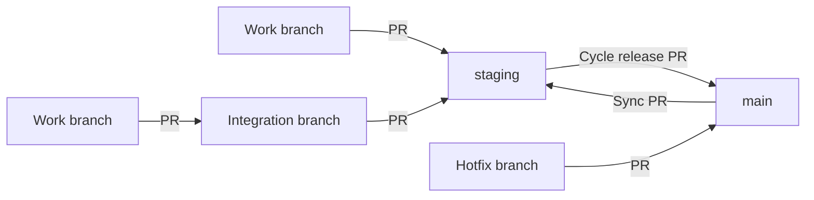

# Branch Basics

How code moves from a work branch to production. This is the Opportunity Tracker flow, and new projects should follow it. Older repositories with an `integration` branch can keep using it until they move over.

## The branches

| Branch | What it is | Deploys to |
| --- | --- | --- |
| `main` | What's in production | Production |
| `staging` | The next release | QA |
| Work branch | One piece of work | Nowhere |
| Integration branch | Large or risky work that lands together | Nowhere |

`main` and `staging` are protected. Changes reach them through a pull request with one approval.

## How code flows



## Naming work branches

```
epic-<epicIssueId>/issue-<workIssueId>/<short-description>
```

Leave out any part you don't have:

| Situation | Branch name |
| --- | --- |
| Has an epic | `epic-503/issue-576/estimate-guard` |
| No epic | `issue-1698/fix-export` |
| Spike with no issue | `spike/try-new-chart` |

Use lowercase words joined with hyphens, and no `#`. The last part describes any kind of work, not only features. Use the issue for the specific work, not only the epic.

## Everyday work

1. Branch from the latest `staging`.
2. Open a pull request into `staging`.
3. Add exactly one release label:
   - `release:minor` for a backward-compatible user-facing feature
   - `release:patch` for fixes, docs, tests, refactors and internal changes
4. Get one approval and merge. QA deploys automatically.

Delete the branch once it's merged.

## Integration branches

Most work goes straight to `staging`. Use an integration branch only for large or risky work that shouldn't land in pieces, such as a new API.

- Branch it from `staging` and name it like any other work branch, ending in `-integration`.
- Each piece of work is its own pull request into the integration branch. Don't stack pull requests on each other.
- Keep it updated from `staging`.
- One pull request takes the whole branch into `staging`.

An integration branch doesn't save CI time, because each pull request into it still runs tests. Use it to control how work lands.

## Cycle releases

When a cycle is ready, open a pull request from `staging` into `main`. The release version comes from the labels on the merged work pull requests. Merging deploys to production automatically.

## Hotfixes

Use a hotfix only for a production problem that can't wait for the next cycle.

1. Branch from the latest `main`, not `staging`.
2. Open a pull request into `main`.
3. Add the `hotfix` label and `release:patch`.
4. Get one approval and merge. Production deploys automatically.
5. Open a sync pull request from `main` into `staging`, and use a merge commit so the release history is kept.

## Manual deploys

Pushes to `main` and `staging` deploy on their own, so a manual run should only be needed for a redeploy or recovery.

| Workflow | Runs from |
| --- | --- |
| Deploy to Prod | `main` only |
| Deploy to QA | `staging` only |

These restrictions are being added to the workflows. Until that's done, only run a deploy from the branch listed here.
